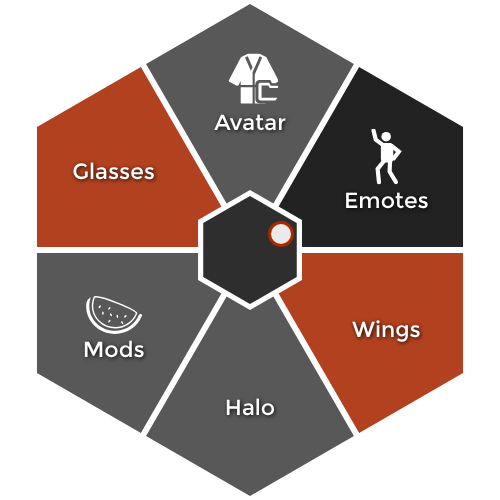
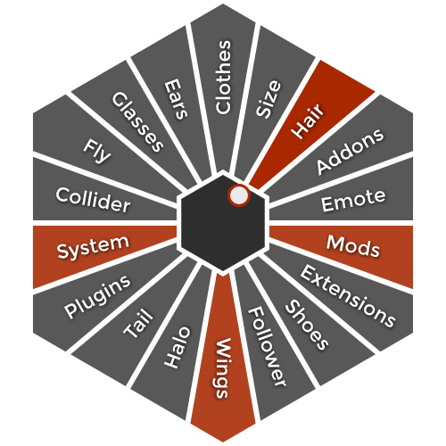
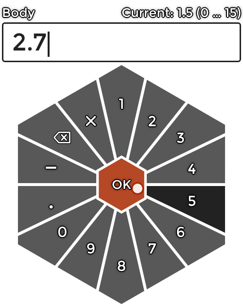
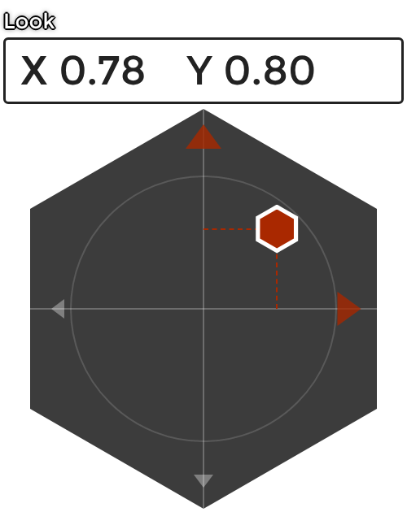
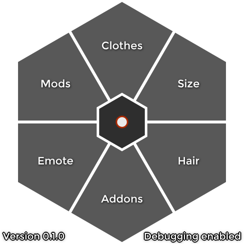

# AdvActionMenu

A reworked version of daky's [Action Menu](https://github.com/dakyneko/DakyModsCVR/tree/main/ActionMenu) for ChilloutVR, with a hexagon design in the style of the ChilloutVR UI

<p align="center">
  
</p>

AdvActionMenu keeps everything you know from the original (avatar toggles, dropdowns, sliders, emotes, profiles, mod menus and your override JSON files) and adds a new look, a number pad for free values and a few quality of life fixes

## Features

- **Hexagon design** in the style of the ChilloutVR UI, for any number of entries from 1 to 30 and more
- **Your UI color:** active toggles use the color you set in ChilloutVR ("Colourize Menu" with your player color, otherwise the default red-orange)
- **Scales with your avatar** in VR and on desktop, also live while using avatar scaling
- **Live parameter sync:** if a parameter changes outside the menu (ChilloutVR menu, avatar logic, OSC, other mods), the menu shows the new state
- **Number pad** for Input Single entries, with an optional min and max per parameter
- **New 2D joystick** with live X/Y values
- **Stable selection:** a few degrees of hysteresis stop the selection from jumping between two entries
- **Desktop keyboard input** for the number pad (digits, Enter, Backspace, Escape)
- **Works next to the original:** if daky's Action Menu is installed too, you choose which one to use and your VR bindings keep working
- **Debug mode** with version display and verbose logging
- **Fix:** the mouse cursor no longer stays unlocked after the menu was closed by opening the ChilloutVR menu (Esc or Tab)

## Screenshots

| Many entries | Number pad | 2D joystick |
| :---: | :---: | :---: |
|  |  |  |
| Names rotate when entries get narrow | OK in the middle, current value and limits above | Marker, guide lines and live values |

## Installation

1. Install [MelonLoader](https://github.com/LavaGang/MelonLoader) for ChilloutVR
2. Install daky's **VRBinding** mod, AdvActionMenu needs it for the VR bindings
3. Put `AdvActionMenu.dll` into the `Mods` folder of ChilloutVR
4. Start the game and open the menu with **R** on desktop, or bind "Open Action Menu" in the SteamVR bindings for ChilloutVR

## Using it together with daky's Action Menu

You can leave daky's `ActionMenu.dll` installed. On the first start, AdvActionMenu asks which menu you want to use:

- **Yes = AdvActionMenu:** the original is paused, its key and VR bindings open AdvActionMenu instead
- **No = original:** AdvActionMenu stays inactive

The answer is saved. To change it later, edit `original_action_menu` in `UserData\MelonPreferences.cfg` (section `[AdvActionMenu]`): `ask`, `advanced` or `original`

> The question is a Windows dialog on your desktop. If you start the game with your headset on, take a quick look at your desktop once

## Number pad

ChilloutVR only stores a default value for Input Single entries, no limits. That's why the number pad accepts any value by default, just like the ChilloutVR menu does

You can add limits in your avatar override JSON:

```json
{
    "name": "Body",
    "action": {
        "type": "avatar parameter",
        "parameter": "Config/Size/Body",
        "control": "number",
        "min_value": 0,
        "max_value": 15
    }
}
```

- `control: "number"` works for avatar parameters, mod callbacks and melon preferences
- Leave out `min_value` and `max_value` for an unlimited value
- Older override files that still use a `0`–`1` radial for an Input Single entry are switched to the number pad automatically. Real sliders and radials with other limits stay as they are

## Override files

Override files work exactly like in the original and are read from the same folders, so your existing files keep working:

- `UserData\ActionMenu\AvatarOverrides\for_<avatar id>.json`
- `UserData\ActionMenu\GlobalOverrides\*.json`

See daky's [documentation](https://github.com/dakyneko/DakyModsCVR/tree/main/ActionMenu) for the full format

## Settings

All settings are in the menu under the mod settings, or in `UserData\MelonPreferences.cfg` under `[AdvActionMenu]`

| Setting | Default | Description |
| --- | --- | --- |
| Scale with avatar | on | Scale size and distance of the menu with your avatar height |
| Resize | 0.5 | Size of the menu |
| Reposition | 0.5, 0.5 | Move the menu off-center |
| Rotation XY | 0, 0 | Tilt the menu |
| Flick select | off | Select an entry by flicking the stick and letting go, no trigger needed |
| Eccentric 'Back' | off | Show the back button as a normal entry instead of the middle |
| No crowded menus | off | Split very full avatar menus into pages |
| Debug mode | off | Verbose logging and version display below the menu |
| Open binding | R | Key to open the menu on desktop |
| Reload binding | F3 | Key to reload the menu (Shift + F3 also reloads the config) |
| Dev mode | off | Don't install the UI files, useful while working on the menu |

## Debug mode



With debug mode on, the version and "Debugging enabled" are shown below the menu, and the MelonLoader log tells you much more, for example:

- Every avatar setting with its parameter and type, like `Avatar setting "Body" (Config/Size/Body): InputSingle -> number`
- Which entries were switched to the number pad
- How many parameters the live sync watches
- Which UI color is used

<br clear="right">

## Building

- Visual Studio 2022 with ".NET desktop development"
- The path to ChilloutVR is set in `Directory.Build.props`, or with the environment variable `CVRPATH`
- Open `ActionMenuAdvanced.sln` and build, or double click `Build.bat`
- The DLL is copied into the `Mods` folder automatically (close ChilloutVR first)

## Credits and license

- Original [Action Menu](https://github.com/dakyneko/DakyModsCVR) by **daky** (dakyneko)
- Rework by **Inazumanotenshi**

Licensed under the GPL-3.0 like the original, see [LICENSE.txt](LICENSE.txt)
