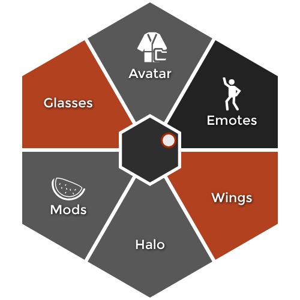
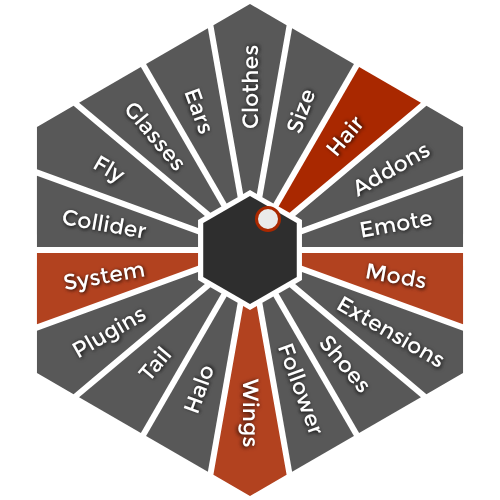
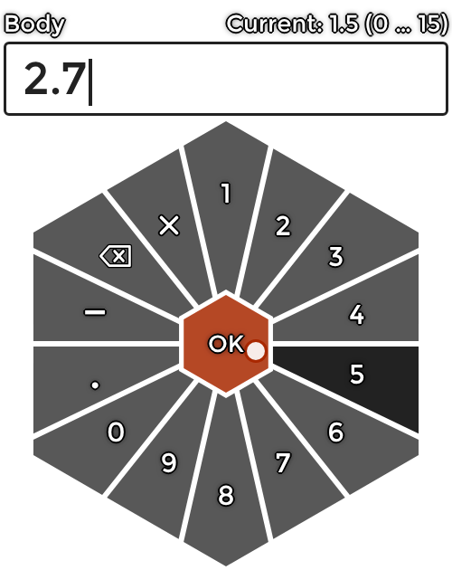
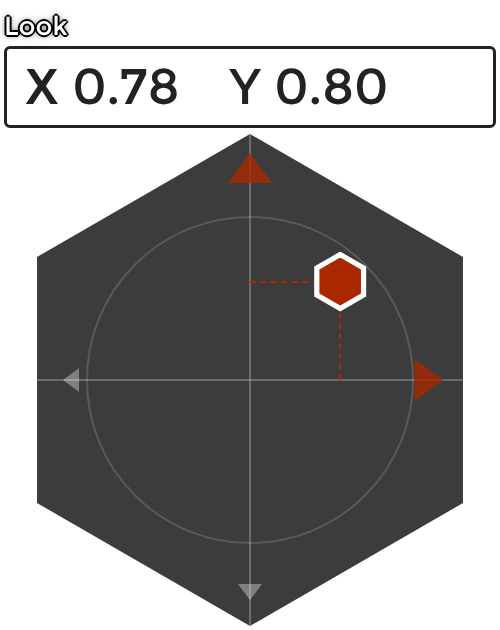
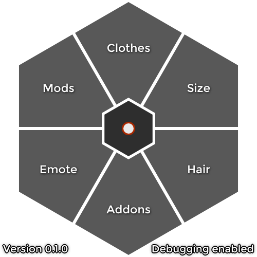

# AdvActionMenu

A reworked version of daky's [Action Menu](https://github.com/dakyneko/DakyModsCVR/tree/main/ActionMenu) for ChilloutVR, with a hexagon design in the style of the ChilloutVR UI

<p align="center">
  
</p>

AdvActionMenu keeps everything you know from the original (avatar toggles, dropdowns, sliders, emotes, profiles, mod menus and your override JSON files) and adds a new look, a number pad for free values and a few quality of life fixes

## Features

- **Hexagon design** in the style of the ChilloutVR UI, for any number of entries from 1 to 30 and more
- **Your UI color:** active toggles use the color you set in ChilloutVR ("Colourize Menu" with your player color, otherwise the default red-orange)
- **Scales with your avatar** in VR and on desktop, also live while using avatar scaling
- **Live parameter sync:** if a parameter changes outside the menu (ChilloutVR menu, avatar logic, OSC, other mods), the menu shows the new state
- **Number pad** for Input Single entries, with an optional min and max per parameter
- **New 2D joystick** with live X/Y values
- **Stable selection:** a few degrees of hysteresis stop the selection from jumping between two entries
- **Desktop keyboard input** for the number pad (digits, Enter, Backspace, Escape)
- **Works next to the original:** if daky's Action Menu is installed too, you choose which one to use and your VR bindings keep working
- **Settings of other mods in the wheel:** pick up to 10 settings of any mod in the Quick Menu, they show up under "Mods"
- **Compatible with mods made for the original:** mods that add their own menus through daky's Action Menu work with AdvActionMenu too
- **Debug mode** with version display and verbose logging
- **Fix:** the mouse cursor no longer stays unlocked after the menu was closed by opening the ChilloutVR menu (Esc or Tab)

## Screenshots

| Many entries | Number pad | 2D joystick |
| :---: | :---: | :---: |
|  |  |  |
| Names rotate when entries get narrow | OK in the middle, current value and limits above | Marker, guide lines and live values |

## Installation

1. Install [MelonLoader](https://github.com/LavaGang/MelonLoader) for ChilloutVR
2. Install daky's **VRBinding** mod, AdvActionMenu needs it for the VR bindings
3. Put `AdvActionMenu.dll` into the `Mods` folder of ChilloutVR
4. Start the game and open the menu with **R** on desktop, or bind "Open Action Menu" in the SteamVR bindings for ChilloutVR

## Using it together with daky's Action Menu

You can leave daky's `ActionMenu.dll` installed. On the first start, AdvActionMenu asks which menu you want to use:

- **Yes = AdvActionMenu:** the original is paused, its key and VR bindings open AdvActionMenu instead
- **No = original:** AdvActionMenu stays inactive

The answer is saved. To change it later, edit `original_action_menu` in `UserData\MelonPreferences.cfg` (section `[AdvActionMenu]`): `ask`, `advanced` or `original`

> The question is a Windows dialog on your desktop. If you start the game with your headset on, take a quick look at your desktop once

## Number pad

ChilloutVR only stores a default value for Input Single entries, no limits. That's why the number pad accepts any value by default, just like the ChilloutVR menu does

You can add limits in your avatar override JSON:

```json
{
    "name": "Body",
    "action": {
        "type": "avatar parameter",
        "parameter": "Config/Size/Body",
        "control": "number",
        "min_value": 0,
        "max_value": 15
    }
}
```

- `control: "number"` works for avatar parameters, mod callbacks and melon preferences
- Leave out `min_value` and `max_value` for an unlimited value
- Older override files that still use a `0`–`1` radial for an Input Single entry are switched to the number pad automatically. Real sliders and radials with other limits stay as they are

## Override files

Override files work exactly like in the original and are read from the same folders, so your existing files keep working:

- `UserData\ActionMenu\AvatarOverrides\for_<avatar id>.json`
- `UserData\ActionMenu\GlobalOverrides\*.json`

See daky's [documentation](https://github.com/dakyneko/DakyModsCVR/tree/main/ActionMenu) for the full format

## Settings of other mods

Many mods only have their settings in the ChilloutVR menu. With the mod slots you can put up to 10 of them into the Action Menu:

1. Open the **Quick Menu** (Tab on desktop, the menu button in VR) and go to the **Misc tab**
2. Under **AdvActionMenu** press **Action Menu mod slots**
3. For each slot choose the **Mod** and then the **Setting**
4. Open the Action Menu: the setting is under **Mods**, in its own entry for that mod

- On/off settings become a **toggle**, selection lists become **options**, numbers get the **number pad** or a **slider** (switch it with **Type**)
- For numbers you can set **Min** and **Max**. If the mod defines a range itself, it's used by default, **Reset range** brings it back
- **Clear slot** removes a setting again, empty slots are not shown
- If a mod already adds its own menu, the slot settings are added to it instead of a second entry
- Changes are saved right away, so mods that only react when their settings are saved pick them up too
- If a mod changes its setting itself, the wheel shows the new value
- Only on/off, number and selection settings are offered. Text fields and key bindings can't be used in the wheel, hidden internal settings of a mod are left out

### Mod icons

Mods without an icon get a puzzle piece under "Mods". To use your own icon, put `<mod name>.svg` or `<mod name>.png` into `UserData\AdvActionMenu\ModIcons` (the folder is created on the first start). The name is either the mod's name as shown in the slot or the name of its section in `MelonPreferences.cfg`, for example `CVR Goes Brrr~.png` or `CVRGoesBrrr.png`

## Settings

All settings are in the menu under the mod settings, or in `UserData\MelonPreferences.cfg` under `[AdvActionMenu]`

| Setting | Default | Description |
| --- | --- | --- |
| Scale with avatar | on | Scale size and distance of the menu with your avatar height |
| Resize | 0.5 | Size of the menu |
| Reposition | 0.5, 0.5 | Move the menu off-center |
| Rotation XY | 0, 0 | Tilt the menu |
| Animation | Spawn | How the entries appear: Spawn, Fade or Disabled (submenu in the Action Menu) |
| Flick select | off | Select an entry by flicking the stick and letting go, no trigger needed |
| Eccentric 'Back' | off | Show the back button as a normal entry instead of the middle |
| No crowded menus | off | Split very full avatar menus into pages |
| Debug mode | off | Verbose logging and version display below the menu |
| Open binding | R | Key to open the menu on desktop |
| Reload binding | F3 | Key to reload the menu (Shift + F3 also reloads the config) |
| Dev mode | off | Don't install the UI files, useful while working on the menu |

## Debug mode



With debug mode on, the version and "Debugging enabled" are shown below the menu, and the MelonLoader log tells you much more, for example:

- Every avatar setting with its parameter and type, like `Avatar setting "Body" (Config/Size/Body): InputSingle -> number`
- Which entries were switched to the number pad
- How many parameters the live sync watches
- Which UI color is used

<br clear="right">

## For modders

AdvActionMenu keeps daky's interface unchanged (`ActionMenu.ActionMenuMod.Lib`, `ActionMenu.API`), so you can add menus exactly like with the original. See daky's [documentation](https://github.com/dakyneko/DakyModsCVR/tree/main/ActionMenu) and the examples there

- **Mods built for the original work without changes:** if daky's `ActionMenu.dll` is not installed, AdvActionMenu answers every request for the `ActionMenu` assembly itself
- **Mod icon:** override `modIcon` in your `Lib` class. A file path, a URL or an inlined image (`data:image/png;base64,...`) all work. Without an icon your mod gets the puzzle piece
- **Icons for your entries:** every `MenuItem` has its own `icon` field, same formats
- **Number pad:** use `control = "number"` with optional `min_value` and `max_value`
- **Settings:** if your mod applies settings in `OnPreferencesSaved`, that's fine, AdvActionMenu saves the MelonPreferences after a change in the wheel. Please don't save MelonPreferences during `OnInitializeMelon`: it triggers `OnPreferencesSaved` of all mods before they are loaded and can crash them

## Building

- Visual Studio 2022 with ".NET desktop development"
- The path to ChilloutVR is set in `Directory.Build.props`, or with the environment variable `CVRPATH`
- Open `ActionMenuAdvanced.sln` and build, or double click `Build.bat`
- The DLL is copied into the `Mods` folder automatically (close ChilloutVR first)

## Credits and license

- Original [Action Menu](https://github.com/dakyneko/DakyModsCVR) by **daky** (dakyneko)
- Rework by **Inazumanotenshi**

Licensed under the GPL-3.0 like the original, see [LICENSE.txt](LICENSE.txt)
